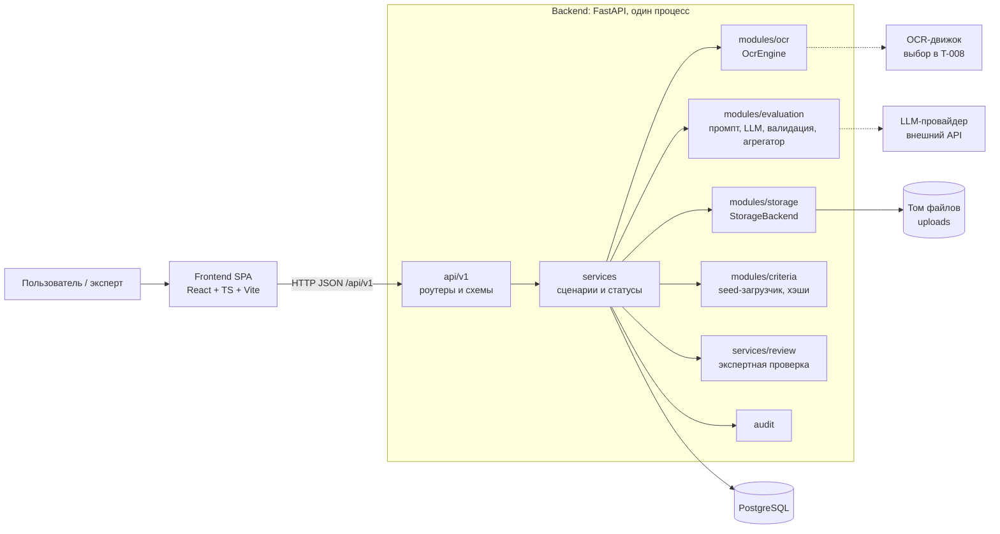
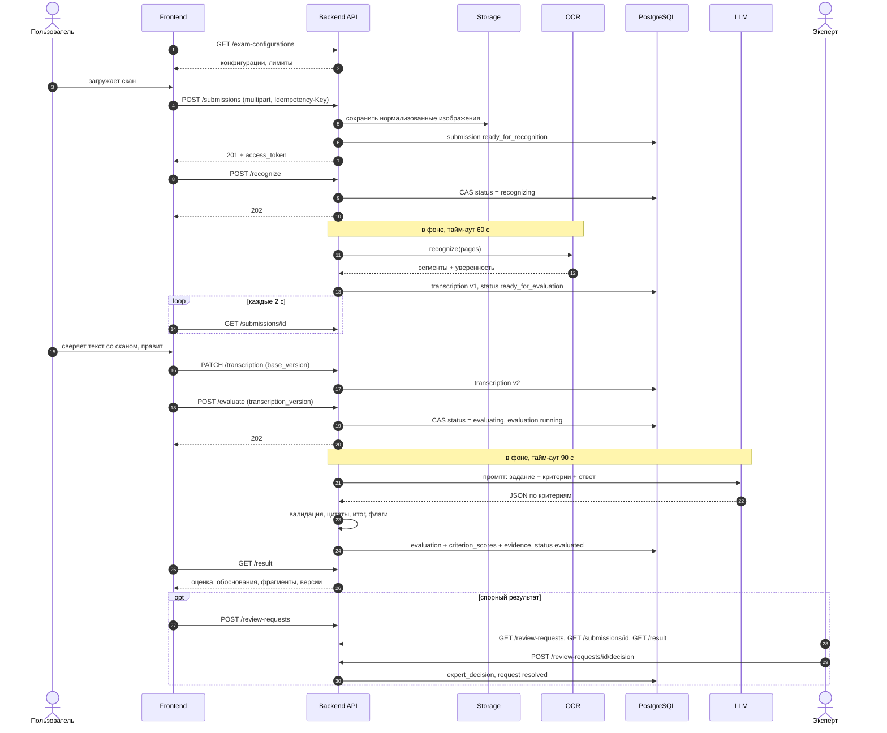
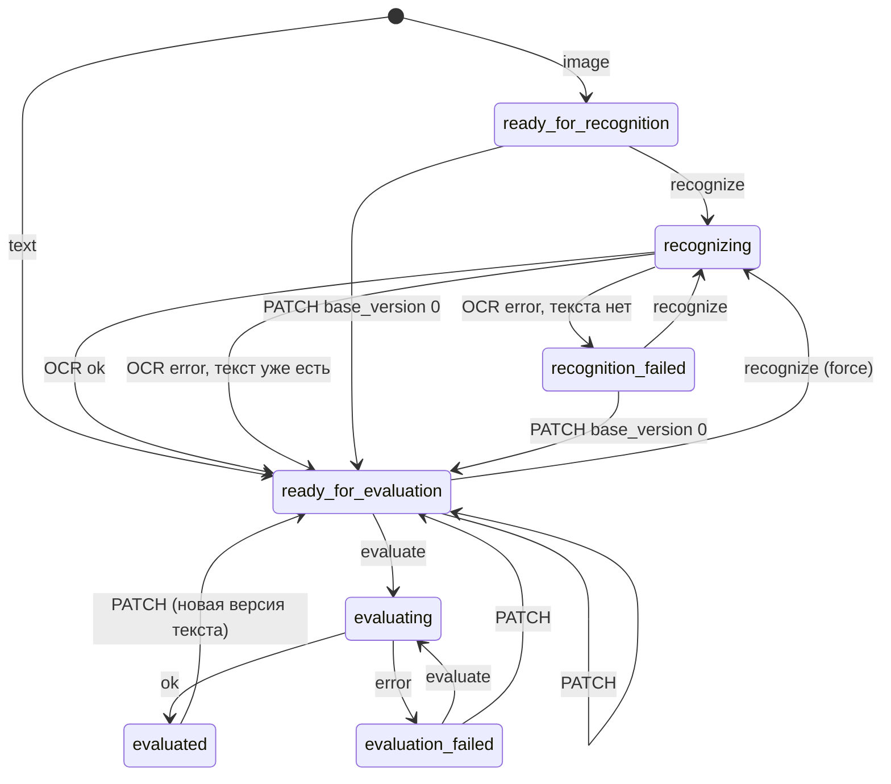

# ARCHITECTURE

Статус: **Proposed** (T-003, роль Architect). Принятие и любые изменения требуют согласования владельца проекта.
Связанные документы: [API_CONTRACT.md](API_CONTRACT.md), [DATA_MODEL.md](DATA_MODEL.md), [ADR-001](DECISIONS/ADR-001-stack.md), [ADR-002](DECISIONS/ADR-002-file-storage.md), [ADR-003](DECISIONS/ADR-003-evaluation-versioning.md).

## 1. Входные данные и допущения

- Прочитаны PROJECT_CONTEXT.md, ACCEPTANCE_CRITERIA.md, TASK_BOARD.md и прежний ARCHITECTURE.md (он содержал только граф зависимостей задач — сохранён в приложении A). API_CONTRACT.md и DATA_MODEL.md были пустыми.
- По TASK_BOARD задача T-001 (исследование ФИПИ) в статусе READY, T-002 (ТЗ) — BLOCKED. Исследования и ТЗ в репозитории нет, поэтому **номер и текст задания, критерии и их редакция не зашиваются в код**: это версионируемые данные (seed) со статусом `draft` до подтверждения. Проверка по неутверждённой конфигурации возможна только при `ALLOW_UNAPPROVED_CONFIG=true` и помечается в результате.
- Границы MVP (PROJECT_CONTEXT): один предмет (история), одно задание, одна подтверждённая версия критериев; без личных кабинетов, платежей, государственных баллов; только синтетические и обезличенные данные.
- Содержимое `docs/` и `DECISIONS/` в репозитории на момент работы прочитать не удалось; если там уже есть ADR или заметки, их нужно слить с документами из этого пакета.

## 2. Принципы

1. **Модульный монолит.** Один backend-процесс, один PostgreSQL, один том файлов. Никаких микросервисов, очередей, Kubernetes, векторной БД.
2. **Границы — интерфейсы, а не сеть.** OCR, LLM и хранилище скрыты за Python-протоколами; есть `mock`-адаптеры для тестов и демо без ключей.
3. **Версионированные данные неизменяемы.** Результат всегда привязан к конкретным версиям и не пересчитывается незаметно (ADR-003).
4. **Модели не доверяем.** Итоговый балл считает код; цитаты проверяются по тексту; баллы ограничены максимумом критерия; ответ ученика — недоверенный ввод для LLM.
5. **Долгие операции асинхронны, состояние — в БД.** Клиент опрашивает статус; потеря процесса не теряет состояние.
6. **Минимум персональных данных.** Нет аккаунтов, имён, IP, имён файлов; автоудаление по TTL.
7. **Контракт первичен.** Имена полей определены в API_CONTRACT.md и DATA_MODEL.md; агенты их не изобретают.

## 3. Компоненты



| Компонент | Ответственность | Не отвечает за |
|---|---|---|
| Frontend | Выбор конфигурации, загрузка, сверка скана с текстом, правка, запуск, показ результата, очередь эксперта | Логику статусов (читает `allowed_actions`), расчёт баллов |
| `api/v1` | Маршруты, Pydantic-схемы, авторизация по заголовкам, единый формат ошибок | Бизнес-правила |
| `services` | Сценарии, переходы статусов, транзакции, квоты, аудит, запуск фоновых задач | Детали OCR/LLM/файлов |
| `modules/storage` | Сохранение/чтение/удаление файлов по ключу | Метаданные (они в БД) |
| `modules/ocr` | Изображения → текст + сегменты с уверенностью | Статусы, БД |
| `modules/evaluation` | Сборка промпта, вызов LLM, валидация ответа, поиск цитат, подсчёт итога, флаги | БД, HTTP |
| `modules/criteria` | Загрузка seed-YAML, проверка согласованности, хэширование версий | Редактирование через API |
| `services/review` | Запрос проверки, решение эксперта, итоговый балл | Изменение исходной оценки |

## 4. Стек (кратко)

Подробности и отвергнутые варианты — в [ADR-001](DECISIONS/ADR-001-stack.md).

Используем: React + TypeScript + Vite (SPA), TanStack Query; Python 3.12 + FastAPI; SQLAlchemy 2.0 (синхронный) + psycopg 3; PostgreSQL 16; Alembic; Pydantic v2 и pydantic-settings; Docker Compose (`db`, `backend`, `web`); pytest; ruff, mypy, eslint, `tsc --strict`; локальный том для файлов за интерфейсом (ADR-002).

Не используем: микросервисы, Celery/Redis/RabbitMQ, Kubernetes, векторную БД/RAG, MinIO/S3, GraphQL, WebSocket/SSE, внешний провайдер аутентификации, SSR.

## 5. Структура репозитория и границы модулей

```
backend/
  app/
    main.py                 # создание приложения, middleware, роутеры
    core/                   # config, errors, logging, security (токены), limits
    db/                     # base, session, models/ (SQLAlchemy)
    schemas/                # Pydantic-схемы API (1:1 с API_CONTRACT.md)
    api/v1/                 # health, exam_configurations, submissions, files,
                            # transcriptions, evaluations, review_requests, deps
    services/               # submission, recognition, evaluation, review, retention, audit
    modules/
      storage/              # base.py (Protocol), local.py
      ocr/                  # base.py, mock.py, <engine>.py
      evaluation/           # prompt.py, llm_client.py, validator.py, aggregate.py, engine.py
      criteria/             # loader.py, hashing.py
    cli.py                  # seed, purge-expired, audit-export
  alembic/  seed/  tests/
frontend/
  src/                      # pages, components, api (типы из openapi.json), hooks
docs/  DECISIONS/
docker-compose.yml
```

Правило зависимостей: `api → services → (modules, db)`. Пакеты `modules/*` не импортируют `api`, `services` и модели БД; обмениваются только DTO (dataclass/Pydantic), описанными в п. 6.

Владение файлами (каждая задача редактирует только своё):

| Задача | Роль | Каталоги |
|---|---|---|
| T-005 Каркас | Integrator | `docker-compose.yml`, структура папок, CI, `.env.example` |
| T-006 Backend | Backend | `app/api`, `app/services`, `app/db`, `app/schemas`, `app/core`, `app/modules/storage`, `alembic` |
| T-007 Frontend | Frontend | `frontend/` |
| T-008 OCR | OCR | `app/modules/ocr` |
| T-009 Evaluation | AI | `app/modules/evaluation`, `app/modules/criteria`, `seed/` |
| T-010 Expert Review | Backend/UI | `app/services/review_service.py`, `app/api/v1/review_requests.py`, экспертные страницы frontend |
| T-011 Security Review | Security | `SECURITY.md`, замечания; код — через владельцев |

Изменение API_CONTRACT.md или DATA_MODEL.md — только по согласованию (PROJECT_CONTEXT).

## 6. Внутренние интерфейсы

Это утверждённые сигнатуры; реализации обязаны им соответствовать. Типы — Python 3.12.

### 6.1 Хранилище

```python
@dataclass(frozen=True)
class StoredObject:
    key: str; size_bytes: int; sha256: str

class StorageBackend(Protocol):
    def put(self, key: str, data: BinaryIO, *, content_type: str) -> StoredObject: ...
    def open(self, key: str) -> BinaryIO: ...      # KeyError, если нет
    def exists(self, key: str) -> bool: ...
    def delete(self, key: str) -> None: ...         # идемпотентно
    def delete_prefix(self, prefix: str) -> int: ...  # число удалённых объектов
```

### 6.2 OCR

```python
@dataclass(frozen=True)
class OcrPageInput:
    page_index: int; image_bytes: bytes; mime_type: str

@dataclass(frozen=True)
class OcrSegment:
    page_index: int; text: str
    confidence: float | None                         # 0..1
    bbox: tuple[float, float, float, float] | None   # нормализованные x0,y0,x1,y1

@dataclass(frozen=True)
class OcrResult:
    segments: list[OcrSegment]                       # в порядке чтения
    mean_confidence: float | None
    engine: str; engine_version: str; params: dict
    warnings: list[str]

class OcrError(Exception):
    code: str          # OCR_TIMEOUT | OCR_ENGINE_ERROR | OCR_EMPTY_RESULT
    retryable: bool

class OcrEngine(Protocol):
    name: str; version: str
    def recognize(self, pages: Sequence[OcrPageInput], *, language: str, timeout_s: float) -> OcrResult: ...
```

Склейку сегментов в `text` и вычисление `char_start/char_end` выполняет `services/recognition_service.py` (единые правила: сегменты через `\n`, страницы через `\n\n`, NFC). Выбор конкретного движка — задача T-008 по бенчмарку на синтетических рукописных образцах; архитектура от выбора не зависит.

### 6.3 LLM-клиент

```python
@dataclass(frozen=True)
class LlmRequest:
    model: str; system: str; user: str
    json_schema: dict; temperature: float
    max_output_tokens: int; timeout_s: float

@dataclass(frozen=True)
class LlmResponse:
    parsed_json: dict; raw_text: str
    model_reported: str | None
    input_tokens: int | None; output_tokens: int | None; latency_ms: int

class LlmError(Exception):
    code: str          # LLM_TIMEOUT | LLM_PROVIDER_ERROR | LLM_INVALID_OUTPUT

class LlmClient(Protocol):
    provider: str
    def complete_json(self, req: LlmRequest) -> LlmResponse: ...
```

Адаптеры: конкретный провайдер(ы) и `mock` (детерминированные ответы из фикстур).

### 6.4 Движок оценивания

```python
@dataclass(frozen=True)
class CriterionSnapshot:
    id: UUID; code: str; position: int; title: str; description: str
    max_score: int; levels: list[dict]

@dataclass(frozen=True)
class EvaluationInput:
    task_statement: str; task_materials: list[dict]
    criteria: list[CriterionSnapshot]; aggregation: dict
    answer_text: str; ocr_mean_confidence: float | None
    profile: ProfileSnapshot            # provider, model_name, parameters, prompts, prompt_sha256

@dataclass(frozen=True)
class EvidenceOutcome:
    kind: Literal["supports", "deficiency"]
    char_start: int; char_end: int; quote: str; note: str | None

@dataclass(frozen=True)
class CriterionOutcome:
    criterion_id: UUID; score: int; confidence: float
    rationale: str; uncertainty_note: str | None
    flags: list[str]; evidence: list[EvidenceOutcome]

@dataclass(frozen=True)
class EvaluationOutcome:
    criteria: list[CriterionOutcome]
    total_score: int; max_score: int
    overall_confidence: float; needs_review: bool; flags: list[str]
    summary: str | None
    model_reported: str | None; input_sha256: str
    raw_output: dict; usage: dict; latency_ms: int

class EvaluationEngine:
    def __init__(self, llm: LlmClient): ...
    def evaluate(self, inp: EvaluationInput) -> EvaluationOutcome: ...   # LlmError пробрасывается
```

Формат ответа модели (`output_schema_version = "1"`): модель возвращает **цитаты, а не смещения**:

```json
{
  "criteria": [
    { "code": "K1", "score": 1, "confidence": 0.8, "rationale": "...",
      "uncertainty_note": null,
      "evidence": [ { "kind": "supports", "quote": "дословная цитата", "note": null } ] }
  ],
  "summary": "..."
}
```

Шаги `evaluate`: собрать промпт (ответ ученика в явных разделителях, инструкция считать его данными) → вызвать LLM → валидировать Pydantic-схемой (одна попытка исправления, `max_repair_attempts`) → для каждой цитаты найти точное вхождение в `answer_text` (после NFC), недостоверные отбросить → ограничить `0 ≤ score ≤ max_score` (иначе ошибка `LLM_INVALID_OUTPUT`) → посчитать `total_score` агрегатором (`sum`) → выставить флаги → `overall_confidence = min(confidence)`.

Флаги: `LOW_CONFIDENCE` (критерий: `confidence < low_confidence_threshold`), `NO_EVIDENCE_FOUND` (`score > 0` без достоверной `supports`), `AMBIGUOUS` (модель указала `uncertainty_note`), `OCR_LOW_QUALITY` (уровень оценки: `ocr_mean_confidence < ocr_low_quality_threshold`). `needs_review = true`, если есть любой флаг.

### 6.5 Агрегатор

```python
def aggregate(scores: Mapping[str, int], rule: dict) -> int   # rule = {"type": "sum"}
```

Чистая функция; используется и оцениванием, и расчётом итога после решения эксперта.

## 7. Обработка ответа



### Состояния отправки



Разрешённые действия по состояниям — таблица `allowed_actions` в API_CONTRACT.md п. 2.2. Backend вычисляет их, frontend только отображает.

## 8. Асинхронность и сроки

- `recognize` и `evaluate` отвечают `202` сразу, а работу выполняет фоновая задача в том же процессе (`BackgroundTasks` с пулом потоков; клиенты синхронные, SQLAlchemy синхронный).
- Запуск защищён атомарным переходом статуса и частичными уникальными индексами (`DATA_MODEL.md`, п. 4–5): два параллельных запроса не создадут два процесса.
- Состояние хранится только в БД. При старте приложение помечает `running`-запуски `failed/INTERRUPTED` и возвращает отправку в предыдущее рабочее состояние. То же делает чтение `GET /submissions/{id}`, если запуск старше `timeout + 30 с`. Планировщик не нужен.
- Тайм-ауты: OCR 60 с (`OCR_TIMEOUT_S`), оценка 90 с (`EVAL_TIMEOUT_S`), обычные запросы 5 с, загрузка 30 с.
- Путь роста без новой инфраструктуры: вынести фоновые задачи в отдельный процесс, который забирает `running`-строки через `SELECT ... FOR UPDATE SKIP LOCKED`. Redis/Celery не добавляются без нового ADR.

## 9. Конфигурация (переменные окружения)

| Переменная | Назначение | По умолчанию |
|---|---|---|
| `APP_ENV` | `dev` \| `prod` | `dev` |
| `DATABASE_URL` | строка подключения PostgreSQL | — |
| `STORAGE_ROOT` | каталог файлов | `/data/uploads` |
| `SUBMISSION_TOKEN_SECRET` | секрет HMAC токенов (обязателен) | — |
| `EXPERT_KEYS` | `label:key,label:key` | пусто (экспертный доступ выключен) |
| `ALLOW_UNAPPROVED_CONFIG` | разрешить `draft`-конфигурации | `false` |
| `SUBMISSION_TTL_DAYS` | срок хранения; `0` = бессрочно | `30` |
| `MAX_EVALUATIONS_PER_DAY` | суточная квота | `200` |
| `OCR_ENGINE`, `OCR_TIMEOUT_S` | движок и тайм-аут | `mock`, `60` |
| `LLM_PROVIDER`, `LLM_API_KEY`, `EVAL_TIMEOUT_S` | провайдер, ключ, тайм-аут | `mock`, —, `90` |
| `MAX_STORAGE_BYTES` | потолок тома файлов | 2 GiB |
| `CORS_ORIGINS` | только для dev | пусто |

Секреты — только из окружения; `.env.example` без значений; ключи и токены не логируются.

## 10. Безопасность и приватность (граница ответственности)

Детальный разбор — T-011 и SECURITY.md. Архитектурные требования:

- Данные только синтетические/обезличенные; `data_origin` обязателен. Текст ответа уходит внешнему LLM-провайдеру — это ограничение демонстрации, фиксируется в SECURITY.md.
- Файлы не отдаются статикой: только через API с проверкой доступа; EXIF снимается; лимиты размера, числа пикселей и типа по сигнатуре (ADR-002).
- Ответ ученика — недоверенный ввод для LLM: разделители, инструкция считать его данными, схема ответа, проверка цитат и границ баллов.
- Нет аккаунтов: токен отправки — «ссылка-ключ»; ключи экспертов в окружении. Сравнение секретов — в постоянном времени.
- Контейнеры: непривилегированный пользователь, том `uploads` только для backend, БД не опубликована наружу.
- Логи структурные (JSON), с `request_id`; без текстов ответов, токенов и ключей.

## 11. Тестирование

| Уровень | Что проверяем | Инструменты |
|---|---|---|
| Юнит | агрегатор, поиск цитат, нормализация текста, флаги, валидатор ответа LLM, хэширование версий | pytest |
| Модуль | OCR-адаптеры и LLM-адаптеры на фикстурах; `mock`-адаптеры | pytest |
| API | все маршруты, коды ошибок, таблица `allowed_actions`, идемпотентность, права | pytest + TestClient + тестовая PostgreSQL |
| Контракт | `openapi.json` совпадает со снимком в `docs/` | pytest |
| Frontend | типы из `openapi.json`, ключевые экраны | Vitest |
| Сквозной демо-сценарий (T-012) | загрузка → OCR → правка → оценка → результат → проверка эксперта | на `mock`-адаптерах |

Тесты не ходят во внешние сети: OCR и LLM заменяются `mock`.

## 12. Открытые вопросы (нужно решение владельца)

1. Принять ли отличия API от предварительного списка: добавлены `DELETE submission`, `GET files/.../content`, `GET transcription`, `GET review-requests`. +
2. Согласен ли подход «токен-ссылка + ключи экспертов» вместо аккаунтов (аккаунты исключены в PROJECT_CONTEXT). +
3. Срок хранения по умолчанию 30 дней и жёсткое удаление — достаточно ли для показа жюри.
4. Допустимо ли отправлять синтетические ответы внешнему LLM-провайдеру; какой провайдер (определяется в T-009).+
5. После T-001/T-002: номер задания, критерии, число критериев и правила агрегации. Если правила не сводятся к сумме, потребуется ADR и расширение `aggregation`. +
6. Движок OCR (T-008) и формат изображений: PDF-сканы в MVP не поддерживаются. +

## Приложение A. Зависимости задач (сохранено из прежней версии)

```
T-001 Research
  ↓
T-002 Product Requirements
  ↓
T-003 Architecture
  ↓
┌─────────────┬─────────────┬─────────────┐
↓             ↓             ↓
T-004         T-005         T-009
Design        Skeleton      Evaluation
└──────┬───────┬──────────┘
       ↓       ↓
     T-006   T-007
     Backend Frontend
       ↓
     T-008
     OCR
       ↓
     T-010
       ↓
     T-011
       ↓
     T-012
       ↓
     T-013
       ↓
     T-014
```

Исходная схема была записана в одну строку, расположение ветвей восстановлено по её тексту; сверьте с замыслом владельца.