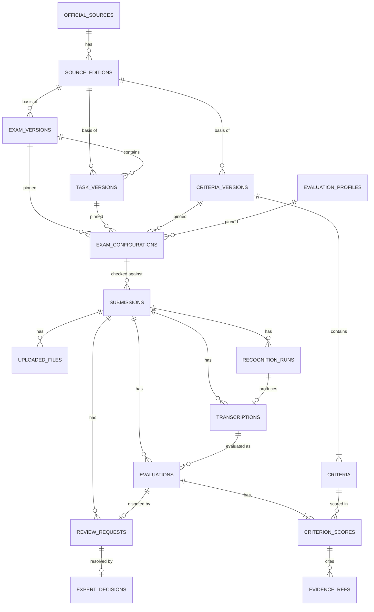

# DATA_MODEL

Статус: **Proposed** (T-003). PostgreSQL 16, миграции Alembic. Имена таблиц и колонок здесь обязательны для реализации (T-006).
Связанные документы: [API_CONTRACT.md](API_CONTRACT.md), [ARCHITECTURE.md](ARCHITECTURE.md), [ADR-003](DECISIONS/ADR-003-evaluation-versioning.md).

## 1. Соглашения

- Первичный ключ: `id uuid PRIMARY KEY DEFAULT gen_random_uuid()` (кроме `audit_log`).
- Время: `timestamptz NOT NULL DEFAULT now()`, хранится в UTC.
- Перечисления: `text` + `CHECK (... IN (...))`, не нативные enum (проще миграции).
- Хэши: `char(64)`, SHA-256 hex в нижнем регистре. Канонизация JSON для хэшей: ключи отсортированы, UTF-8, без пробелов, строки в NFC.
- `jsonb` — только для вложенных структур, по которым не нужны запросы.
- Внешние ключи справочных данных: `ON DELETE RESTRICT`. Дочерние данные отправки: `ON DELETE CASCADE`.
- Справочные данные (раздел 3) загружаются из `backend/seed/*.yaml` командой `python -m app.cli seed` и не редактируются через API.
- Персональных данных нет: нет имён, e-mail, IP, имён файлов, учётных записей. Только синтетические или обезличенные ответы (`submissions.data_origin`).

## 2. Схема связей

Не показаны: `audit_log` (без внешних ключей, чтобы переживать удаление отправок).

## 3. Справочные (версионируемые) данные

После `status = 'approved'` строки **неизменяемы** (ADR-003). Любая правка = новая версия.
Общие колонки версионируемых таблиц: `status text NOT NULL CHECK (status IN ('draft','approved','retired'))`, `content_sha256 char(64) NOT NULL`, `approved_at timestamptz NULL`, `approved_by text NULL`, `created_at`.

### official_sources — источник официальных материалов
| Колонка | Тип | Null | Описание |
|---|---|---|---|
| publisher | text | нет | например `ФИПИ` |
| title | text | нет | название документа |
| kind | text | нет | CHECK: `demo_version`, `specification`, `codifier`, `scoring_criteria`, `methodical`, `other` |
| created_at | timestamptz | нет | |

UNIQUE (`publisher`, `title`).

### source_editions — редакция источника
| Колонка | Тип | Null | Описание |
|---|---|---|---|
| source_id | uuid FK→official_sources | нет | |
| edition_label | text | нет | например `2026` |
| published_at | date | да | дата публикации редакции |
| retrieved_at | timestamptz | да | когда материал получен и сверен |
| url | text | да | постоянная ссылка на редакцию |
| content_sha256 | char(64) | да | хэш скачанного документа (сам документ в БД не хранится) |
| note | text | да | |
| created_at | timestamptz | нет | |

UNIQUE (`source_id`, `edition_label`).

### exam_versions — версия экзамена
| Колонка | Тип | Null | Описание |
|---|---|---|---|
| exam_code | text | нет | `ege-history` |
| subject | text | нет | `history` |
| title | text | нет | |
| version_label | text | нет | например `ЕГЭ-2026` |
| exam_year | int | нет | |
| source_edition_id | uuid FK→source_editions | нет | |
| + общие колонки версий | | | |

UNIQUE (`exam_code`, `version_label`).

### task_versions — задание и его версии
| Колонка | Тип | Null | Описание |
|---|---|---|---|
| task_key | text | нет | стабильный идентификатор задания |
| version | int | нет | с 1 |
| exam_version_id | uuid FK→exam_versions | нет | |
| task_number | text | да | **NULL, пока номер не утверждён по материалам ФИПИ** |
| title | text | нет | |
| statement | text | нет | текст задания |
| materials | jsonb | нет | `[{kind,title,content}]`, по умолчанию `[]` |
| max_score | int | нет | CHECK > 0 |
| source_edition_id | uuid FK→source_editions | нет | |
| + общие колонки версий | | | |

UNIQUE (`task_key`, `version`).

### criteria_versions — версия набора критериев
| Колонка | Тип | Null | Описание |
|---|---|---|---|
| task_key | text | нет | к какому заданию относятся |
| version | int | нет | с 1 |
| aggregation | jsonb | нет | `{"type":"sum"}`; другие типы — только через ADR |
| max_score_total | int | нет | при `sum` равен сумме `criteria.max_score` (проверяет seed-загрузчик) |
| source_edition_id | uuid FK→source_editions | нет | редакция критериев оценивания |
| + общие колонки версий | | | |

UNIQUE (`task_key`, `version`).

### criteria — критерии
| Колонка | Тип | Null | Описание |
|---|---|---|---|
| criteria_version_id | uuid FK→criteria_versions | нет | |
| code | text | нет | `K1`, `K2`, … |
| position | int | нет | порядок показа, с 1 |
| title | text | нет | |
| description | text | нет | |
| max_score | int | нет | CHECK > 0 |
| levels | jsonb | нет | `[{score,description}]` |

UNIQUE (`criteria_version_id`, `code`), UNIQUE (`criteria_version_id`, `position`).

### evaluation_profiles — промпт и конфигурация оценивания
| Колонка | Тип | Null | Описание |
|---|---|---|---|
| code | text | нет | |
| version | int | нет | с 1 |
| provider | text | нет | `anthropic`, `openai`, `mock`, … |
| model_name | text | нет | запрошенная модель |
| parameters | jsonb | нет | `{temperature, max_output_tokens, timeout_s, low_confidence_threshold, ocr_low_quality_threshold, max_repair_attempts}` |
| system_prompt | text | нет | |
| user_prompt_template | text | нет | |
| output_schema_version | text | нет | версия JSON-схемы ответа модели, `1` |
| prompt_sha256 | char(64) | нет | хэш (`system_prompt` + `user_prompt_template` + `output_schema_version`) |
| + общие колонки версий | | | |

UNIQUE (`code`, `version`).

### exam_configurations — закреплённый набор версий
| Колонка | Тип | Null | Описание |
|---|---|---|---|
| slug | text | нет | UNIQUE, например `ege-history-demo` |
| exam_version_id | uuid FK | нет | |
| task_version_id | uuid FK | нет | |
| criteria_version_id | uuid FK | нет | |
| evaluation_profile_id | uuid FK | нет | |
| limits | jsonb | нет | `{max_files,max_file_bytes,allowed_mime_types,min_answer_chars,max_answer_chars}` |
| is_default | boolean | нет | по умолчанию `false` |
| + общие колонки версий | | | |

Частичный UNIQUE-индекс: один `is_default` среди `status = 'approved'`.
Согласованность (проверяет seed-загрузчик и тест): `task_versions.exam_version_id = exam_version_id`; `criteria_versions.task_key = task_versions.task_key`; конфигурация может быть `approved` только если все четыре компонента `approved`.

## 4. Данные отправки

### submissions
| Колонка | Тип | Null | Описание |
|---|---|---|---|
| exam_configuration_id | uuid FK RESTRICT | нет | закрепляется навсегда |
| status | text | нет | CHECK: `ready_for_recognition`, `recognizing`, `recognition_failed`, `ready_for_evaluation`, `evaluating`, `evaluation_failed`, `evaluated` |
| input_mode | text | нет | `image` \| `text` |
| data_origin | text | нет | `synthetic` \| `anonymized` |
| current_transcription_id | uuid FK→transcriptions | да | DEFERRABLE INITIALLY DEFERRED |
| idempotency_key | text | да | UNIQUE (где не NULL) |
| request_fingerprint | char(64) | нет | хэш содержимого создающего запроса |
| created_at, updated_at | timestamptz | нет | |
| expires_at | timestamptz | да | `created_at + SUBMISSION_TTL_DAYS`; NULL = не удалять |

Индексы: (`expires_at`) WHERE `expires_at IS NOT NULL`; (`status`).
Токен доступа **не хранится**: `HMAC-SHA256(SUBMISSION_TOKEN_SECRET, id)`.

### uploaded_files
| Колонка | Тип | Null | Описание |
|---|---|---|---|
| submission_id | uuid FK CASCADE | нет | |
| page_index | smallint | нет | с 0 |
| storage_key | text | нет | UNIQUE; `submissions/{submission_id}/{file_id}.{ext}` |
| mime_type | text | нет | после нормализации |
| size_bytes | int | нет | |
| width_px, height_px | int | нет | |
| sha256 | char(64) | нет | хэш сохранённого (нормализованного) файла |
| created_at | timestamptz | нет | |

UNIQUE (`submission_id`, `page_index`). Имя исходного файла не хранится (может содержать ПДн).

### recognition_runs
| Колонка | Тип | Null | Описание |
|---|---|---|---|
| submission_id | uuid FK CASCADE | нет | |
| attempt_no | int | нет | с 1 |
| status | text | нет | `running` \| `succeeded` \| `failed` |
| engine, engine_version | text | нет | |
| params | jsonb | нет | параметры движка |
| started_at | timestamptz | нет | |
| finished_at | timestamptz | да | |
| error_code, error_message | text | да | без содержимого ответа |
| transcription_id | uuid FK | да | заполняется при `succeeded` |

UNIQUE (`submission_id`, `attempt_no`); частичный UNIQUE (`submission_id`) WHERE `status = 'running'`.

### transcriptions — распознанный/введённый текст (версии, неизменяемы)
| Колонка | Тип | Null | Описание |
|---|---|---|---|
| submission_id | uuid FK CASCADE | нет | |
| version | int | нет | с 1 |
| source | text | нет | `ocr` \| `manual_input` \| `user_edit` |
| parent_transcription_id | uuid FK | да | предыдущая версия |
| recognition_run_id | uuid FK | да | только для `ocr` |
| text | text | нет | NFC, `\n` |
| text_sha256 | char(64) | нет | |
| char_count | int | нет | кодовые точки |
| ocr_mean_confidence | numeric(3,2) | да | |
| ocr_segments | jsonb | да | `[{index,page_index,char_start,char_end,confidence,bbox}]` |
| created_at | timestamptz | нет | |

UNIQUE (`submission_id`, `version`). Строки не обновляются: правка = новая строка.

### evaluations — результат оценивания (неизменяем)
| Колонка | Тип | Null | Описание |
|---|---|---|---|
| submission_id | uuid FK CASCADE | нет | |
| transcription_id | uuid FK | нет | какая версия текста оценивалась |
| transcription_sha256 | char(64) | нет | копия `text_sha256` |
| attempt_no | int | нет | с 1 в пределах отправки |
| status | text | нет | `running` \| `succeeded` \| `failed` |
| exam_configuration_id | uuid FK | нет | |
| task_version_id | uuid FK | нет | **копия версии на момент оценки** |
| criteria_version_id | uuid FK | нет | |
| evaluation_profile_id | uuid FK | нет | |
| model_provider | text | нет | |
| model_requested | text | нет | |
| model_reported | text | да | точное имя/снимок модели из ответа провайдера |
| prompt_sha256 | char(64) | нет | из профиля |
| input_sha256 | char(64) | да | хэш фактически отправленного промпта |
| total_score | int | да | NOT NULL при `succeeded` |
| max_score | int | нет | |
| overall_confidence | numeric(3,2) | да | минимум по критериям |
| needs_review | boolean | да | |
| flags | jsonb | нет | `[]` по умолчанию |
| summary | text | да | |
| raw_output | jsonb | да | ответ модели после парсинга (для аудита) |
| usage | jsonb | да | `{input_tokens,output_tokens}` |
| latency_ms | int | да | |
| started_at | timestamptz | нет | |
| finished_at | timestamptz | да | |
| error_code, error_message | text | да | |

Ограничения: UNIQUE (`submission_id`, `attempt_no`); частичный UNIQUE (`transcription_id`) WHERE `status IN ('running','succeeded')` (идемпотентность оценки версии текста); частичный UNIQUE (`submission_id`) WHERE `status = 'running'`; CHECK (`status <> 'succeeded' OR total_score IS NOT NULL`).
Индекс: (`submission_id`, `started_at` DESC).

### criterion_scores
| Колонка | Тип | Null | Описание |
|---|---|---|---|
| evaluation_id | uuid FK CASCADE | нет | |
| criterion_id | uuid FK→criteria | нет | |
| score | int | нет | CHECK ≥ 0; ≤ `criteria.max_score` проверяет приложение |
| confidence | numeric(3,2) | нет | CHECK между 0 и 1 |
| rationale | text | нет | |
| uncertainty_note | text | да | |
| flags | jsonb | нет | `[]` по умолчанию |

UNIQUE (`evaluation_id`, `criterion_id`).

### evidence_refs — доказательные фрагменты
| Колонка | Тип | Null | Описание |
|---|---|---|---|
| criterion_score_id | uuid FK CASCADE | нет | |
| position | smallint | нет | порядок внутри критерия |
| kind | text | нет | `supports` \| `deficiency` |
| char_start, char_end | int | нет | CHECK `char_start >= 0 AND char_end > char_start`; смещения в `transcriptions.text` оцениваемой версии |
| quote | text | нет | копия подстроки; приложение гарантирует `text[char_start:char_end] = quote` |
| note | text | да | |

Индекс: (`criterion_score_id`).

### review_requests
| Колонка | Тип | Null | Описание |
|---|---|---|---|
| submission_id | uuid FK CASCADE | нет | |
| evaluation_id | uuid FK | нет | UNIQUE (один запрос на оценку) |
| status | text | нет | `open` \| `resolved` |
| reason_code | text | нет | `disagree_with_score`, `ocr_error`, `unclear_rationale`, `other` |
| criterion_codes | jsonb | нет | `[]` по умолчанию |
| comment | text | да | ≤ 1000 |
| created_at | timestamptz | нет | |
| resolved_at | timestamptz | да | |

Индекс: (`status`, `created_at`).

### expert_decisions
| Колонка | Тип | Null | Описание |
|---|---|---|---|
| review_request_id | uuid FK CASCADE | нет | UNIQUE |
| outcome | text | нет | `confirmed` \| `adjusted` |
| criterion_adjustments | jsonb | нет | `[{criterion_code,original_score,score,comment}]` |
| final_total_score | int | нет | |
| max_score | int | нет | |
| comment | text | нет | ≤ 2000 |
| decided_by | text | нет | метка эксперта |
| request_fingerprint | char(64) | нет | для проверки идемпотентного повтора |
| decided_at | timestamptz | нет | |

Исходная оценка не изменяется; «итоговый» балл — это `evaluations` плюс `expert_decisions`.

### audit_log
| Колонка | Тип | Null | Описание |
|---|---|---|---|
| id | bigint GENERATED ALWAYS AS IDENTITY | нет | PK |
| occurred_at | timestamptz | нет | |
| actor_type | text | нет | `submitter` \| `expert` \| `system` |
| actor_ref | text | да | метка эксперта; для submitter NULL |
| action | text | нет | см. ниже |
| entity_type | text | нет | `submission`, `evaluation`, `review_request`, `exam_configuration`, … |
| entity_id | uuid | да | **без FK** |
| request_id | text | да | |
| details | jsonb | нет | только технические данные (статусы, коды, версии, хэши); **никогда текст ответа, токены, ключи** |

Индексы: (`occurred_at`), (`entity_type`, `entity_id`).
Только добавление: триггер `BEFORE UPDATE OR DELETE` вызывает исключение.
Действия: `config.seeded`, `config.approved`, `submission.created`, `submission.deleted`, `submission.expired`, `file.uploaded`, `recognition.started|succeeded|failed`, `transcription.created`, `evaluation.started|succeeded|failed`, `review_request.created`, `expert_decision.created`.
HTTP-маршрута для аудита в MVP нет; чтение — SQL или `python -m app.cli audit-export`.

## 5. Целостность и конкурентность

- Переходы статусов — атомарное сравнение-и-замена: `UPDATE submissions SET status = :new WHERE id = :id AND status = ANY(:allowed) RETURNING *`. Ноль строк → `409 INVALID_STATE`.
- Создание транскрипции и смена `current_transcription_id`/`status` — одна транзакция. Версия = `max(version)+1` внутри транзакции под `SELECT ... FOR UPDATE` строки отправки; `PATCH` сверяет `base_version`.
- Сохранение успешной оценки (`evaluations`, `criterion_scores`, `evidence_refs`, смена `status` отправки, запись аудита) — одна транзакция.
- Устаревшая оценка: `evaluations.transcription_id <> submissions.current_transcription_id` (в API — `is_current = false`).

## 6. Жизненный цикл данных

| Событие | Что происходит |
|---|---|
| `expires_at` наступил | Фоновая очистка (раз в час и командой `python -m app.cli purge-expired`) удаляет отправку каскадно, файлы в хранилище и пишет `submission.expired` в аудит |
| `DELETE /submissions/{id}` | То же немедленно; аудит `submission.deleted` |
| Утверждение новой версии критериев | Старые версии и все оценки не меняются; новые отправки используют `is_default` конфигурацию |
| Перезапуск процесса во время обработки | Зависшие `running` помечаются `failed/INTERRUPTED` при старте и лениво при чтении |

Справочные данные и `audit_log` не удаляются автоматически.

## 7. Что намеренно не хранится

Имена, контакты, IP-адреса, имена загруженных файлов, EXIF (снимается при нормализации), токены доступа, ключи API, оригиналы изображений до нормализации, тексты промптов с данными пользователя вне `evaluations.raw_output`, официальные документы ФИПИ целиком (хранятся только ссылка и хэш).

## 8. Миграции

- Alembic, одна начальная миграция `0001_initial` на всю схему; последующие — по одной на изменение.
- Автогенерацию использовать только как черновик; миграцию проверять вручную, `downgrade` обязателен.
- Триггер append-only для `audit_log` и частичные индексы создаются явным SQL в миграции.
- Данные (seed) в миграции не кладутся.